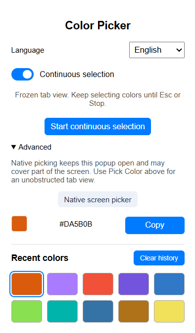
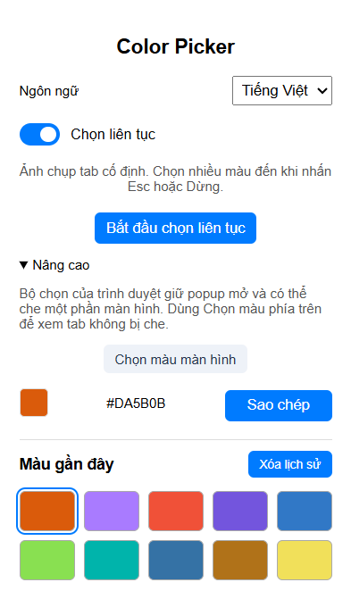
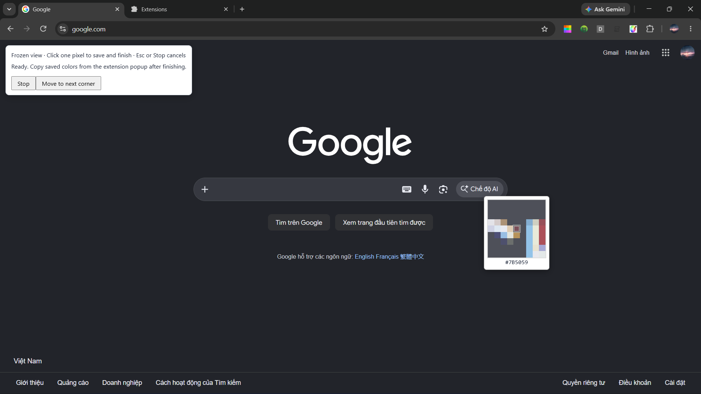
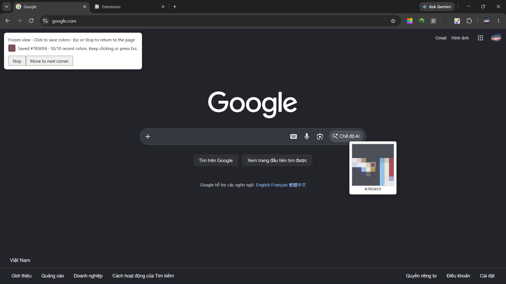
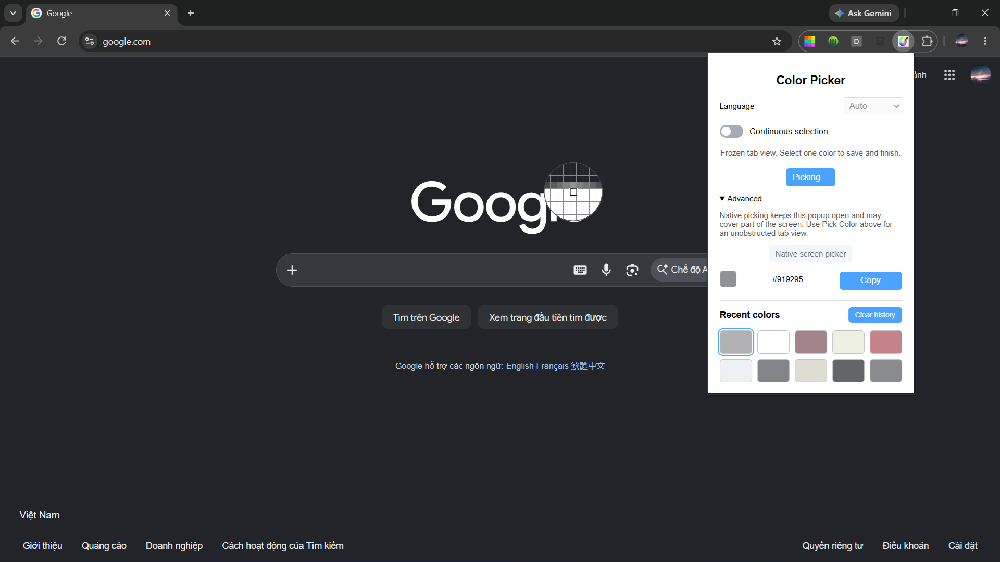
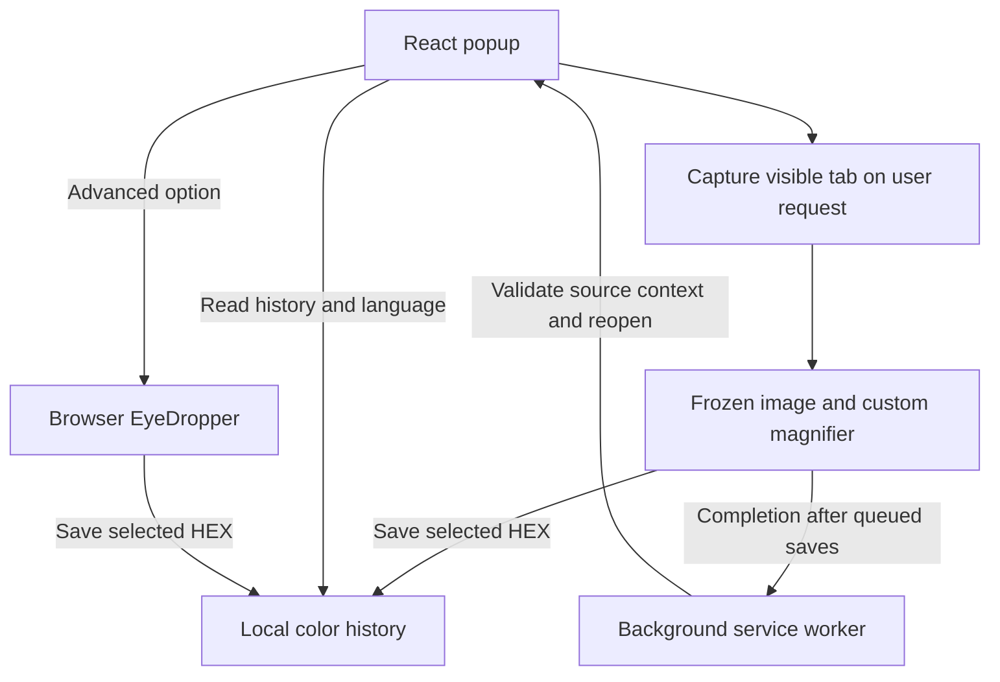

# Color Picker

A Chrome Manifest V3 extension built with React 19, TypeScript, and Vite 7. Use the same magnifier on a frozen tab view for single or continuous selection. A separate native screen picker remains available as an explicit alternative.

## Contents

- [Current features](#current-features)
- [Localization](#localization)
- [Install from GitHub Releases](#install-from-github-releases)
- [Build from source](#build-from-source)
- [Pick colors](#pick-colors)
- [Architecture](#architecture)
- [Tech stack](#tech-stack)
- [Development commands](#development-commands)
- [Permissions and data](#permissions-and-data)
- [Troubleshooting](#troubleshooting)
- [Verification](#verification)
- [CI and delivery](#ci-and-delivery)
- [Documentation](#documentation)
- [Author](#author)
- [Contributing](#contributing)
- [License](#license)

## Current features

- **Single or continuous selection:** use the same pixel magnifier on a frozen image of the visible tab. Save one color and finish, or keep selecting until Esc or Stop.
- **Native screen picker:** choose the browser's EyeDropper under Advanced to sample a screen pixel beyond the tab. This alternative selects one color at a time and keeps the popup visible.
- **Recent-color history:** retain the newest ten distinct colors locally. Repicking a color moves it to the front; selecting a history swatch only changes the displayed result. Clear history removes saved colors, and older histories are trimmed to ten on load.
- **Color preview and explicit copying:** view a swatch and uppercase sRGB HEX value. Only Copy writes to the clipboard; successful copying shows a disabled Copied! button for two seconds.
- **Session controls and popup return:** move instructions between screen corners, exit with Esc or Stop, and return to the popup after queued saves finish when the source tab and window remain active.
- **English and Vietnamese:** choose either language or Auto to follow the browser language with English fallback. Preferences persist locally; the Color Picker product name stays unchanged.
- **On-device processing:** screenshots are processed in memory and are not uploaded or stored in extension storage. Colors and preferences stay in local extension storage. See [privacy and temporary session metadata](docs/guides/PRIVACY.md).

Custom selection captures ordinary HTTP/HTTPS tabs and uses a frozen viewport, rather than a live page or whole-screen feed. See [Pick colors](#pick-colors) for the workflow and limitations.





## Localization

Choose Auto / English / Tiếng Việt in the popup. Auto follows the browser language with English fallback. The preference is saved locally. See [localization](docs/guides/LOCALIZATION.md).

## Install from GitHub Releases

Requires desktop Chrome or Edge 127+. No Node.js installation or local build is needed for this method.

1. Open [Releases](https://github.com/tlavu2004/color-picker/releases) and choose a published version. If there is no release yet, use the source-build instructions below.
2. Under **Assets**, download `color-picker.zip`. Use this extension package rather than GitHub's automatically generated **Source code** archives.
3. Extract the ZIP into a permanent folder. The selected folder must directly contain `manifest.json`; keep the extracted files in place while the extension is installed.
4. Open `chrome://extensions` or `edge://extensions`, enable **Developer mode**, and click **Load unpacked**.
5. Select the extracted folder, then open Color Picker from the browser's extensions menu. Pin it to the toolbar if desired.

For updates, download and extract the new release into the same folder, replacing the previous files, then click **Reload** on the extension's card. Reopen the popup and acknowledge any new permission prompt. Loading a different folder as another unpacked extension may create a separate installation with separate saved data. GitHub ZIP installations do not update automatically.

Each release also provides `color-picker.zip.sha256`. To check the ZIP on Windows, run `Get-FileHash ./color-picker.zip -Algorithm SHA256` and compare the hash with the checksum file.

Before a release is published, reviewers can download the **color-picker** artifact from a successful GitHub Actions run for the intended commit. Extract the artifact first, then extract its inner `color-picker.zip` and follow the same Load unpacked steps. An Actions artifact is a review build, not a published release.

## Build from source

Use desktop Chrome/Edge 127+ and Node.js 24.15.0+ (24.x), matching `.node-version` and CI.

```powershell
git clone https://github.com/tlavu2004/color-picker.git
cd color-picker
npm ci
npm run build
npm run verify:build
```

Open `chrome://extensions` or `edge://extensions`, enable Developer mode, and Load unpacked this project's `dist/` directory. After editing, rebuild and Reload the extension. This update adds scripting permission; acknowledge a browser permission prompt if shown. Close any old snapshot window from the previous implementation.

## Pick colors

- Switch off: **Pick Color** opens the tab overlay and magnifier. One click saves a color and closes the overlay only after the save succeeds.
- Switch on: **Start continuous selection** captures the visible tab, opens an overlay with a magnifier on the same tab, and closes the popup. No separate capture window is created.
- Both modes use the same enlarged pixels, center marker, and HEX preview. In continuous mode, click multiple points without closing the magnifier. If saving fails in single mode, the overlay stays open so you can retry.
- Under **Advanced**, **Native screen picker** explicitly opens the original EyeDropper for one screen pixel, including outside the tab. It is available when continuous selection is off and is never selected automatically. It keeps the popup open and may obscure part of the screen; use the main tab picker for an unobstructed view.
- Use **Move to next corner** to reach pixels covered by the instructions.
- **Esc** or **Stop** removes the image and magnifier and returns to the page. The popup reopens automatically after saves finish if the same source tab/window is still active. It restores the selected mode and latest color; copying remains explicit.
- Saves retain the newest **10** distinct colors. Rapid clicks are serialized so one selection does not overwrite another.

The displayed tab image is frozen; page code can continue running beneath it. Scrolling is blocked during selection. Resize, viewport changes, or navigation end the overlay. Stop and start again to capture new content. Advanced grid/keyboard precision controls remain deferred.





### Native screen picker

Expand **Advanced** and click **Native screen picker** to use the browser's one-color EyeDropper. Turn off Continuous selection first; the native button is disabled while it is enabled. Its magnifier is controlled by the browser, and the popup stays visible while selecting.



## Architecture

The popup starts selection, displays history, and handles explicit copying. The custom picker runs on the source tab; a background service worker coordinates returning to the popup after selection ends.



Screenshots stay in memory. Temporary popup-return metadata is kept in session storage. See [architecture and source responsibilities](docs/guides/ARCHITECTURE.md) for lifecycle details and [privacy](docs/guides/PRIVACY.md) for data handling.

## Tech stack

| Area | Technology |
| --- | --- |
| Extension platform | Chrome Manifest V3, activeTab/scripting APIs, module service worker |
| Popup | React 19, TypeScript, plain CSS |
| Custom picker | Canvas, ImageBitmap, modal dialog, closed shadow DOM |
| Build and development | Vite 7, Node.js 24, npm |
| Tests | Vitest, React Testing Library, jsdom, V8 coverage |
| Delivery | GitHub Actions, version-tagged ZIP releases and SHA-256 checksums |

Vite builds the extension; installed users do not need a Vite server or Node.js.

## Development commands

| Command | Purpose |
| --- | --- |
| `npm run dev` | Start Vite; open `/src/index.html` on the URL printed in the terminal for layout work |
| `npm run build` | Check TypeScript and build the unpacked extension into `dist/` |
| `npm run preview` | Serve the production build for layout inspection at `/src/index.html` |
| `npm run lint` | Lint TypeScript and TSX source |
| `npm test` | Run Vitest service and popup tests |

## Permissions and data

Requests **storage**, **activeTab**, and **scripting** for user-started capture/injection. No automatic content script, broad website access, account, or server upload is used. A small module service worker restores the popup for completed/cancelled custom sessions. The screenshot stays in the isolated picker and is not written to local/session storage. Ordinary HTTP/HTTPS pages support the overlay subject to browser injection restrictions; use native picking on restricted pages.

## Troubleshooting

| Symptom | What to check |
| --- | --- |
| Load unpacked cannot find the manifest | Extract the extension ZIP and select the folder directly containing `manifest.json`. For a source build, select `dist/`. |
| The popup says scripting permission is unavailable | Reload the extension on `chrome://extensions` or `edge://extensions`, acknowledge new permissions if prompted, then close and reopen the popup. Reloading only the website does not apply manifest changes. |
| Custom picking fails on a restricted page | Use an ordinary HTTP/HTTPS page or explicitly choose Advanced → Native screen picker. Browser restrictions can prevent injection. |
| The overlay ends after resizing or zooming | This protects coordinate mapping. Finish changing the viewport, reset pinch zoom, and start a new capture. |
| The captured page looks out of date | Custom selection uses a frozen screenshot. Stop and start again to capture the current visible page. |
| The popup does not reopen | Keep the source tab active and its window focused. Navigation or viewport cleanup cancels automatic return. If the browser refuses opening, click the extension icon; a dot badge may indicate saved results. |
| An update seems unchanged | Check the loaded extension's folder, rebuild if using source, click Reload on its card, and reopen the popup. Disable duplicate unpacked installations while checking. |

If the problem persists, include reproduction steps and browser/extension versions in a bug report. The [continuous-selection guide](docs/guides/CONTINUOUS_SELECTION.md) includes additional browser checks.

## Verification

```powershell
npm run lint
npm run test:typecheck
npm test
npm run test:coverage
npm run build
npm run verify:build
```

Vitest and React Testing Library cover history, native selection, popup/clipboard, overlay startup, magnification, queued saves, cleanup, and popup restoration with mocked browser APIs. Real capture, permissions, focus, and page interaction require browser verification. See [testing and delivery](docs/guides/TESTING.md) and the [continuous-selection checklist](docs/guides/CONTINUOUS_SELECTION.md).

`npm run dev` and `npm run preview` serve `/src/index.html` for layout work; use the built extension for browser APIs.

## CI and delivery

GitHub Actions verifies PRs targeting main and pushes to main on Node.js 24, using a shared verify workflow. Feature branch pushes do not duplicate PR checks; use manual dispatch when needed. Coverage is shown in the job summary and uploaded with a verified extension ZIP and SHA-256 checksum. Pushing a matching version tag publishes that same verified archive to a GitHub release, without rebuilding; no Web Store deployment is configured. See [testing and delivery](docs/guides/TESTING.md) before creating a release tag.

## Documentation

- [Localization behavior and verification](docs/guides/LOCALIZATION.md)
- [Architecture and source layout](docs/guides/ARCHITECTURE.md)
- [Existing features and planned work](docs/guides/FEATURES.md)
- [Precision selection investigation backlog](docs/guides/BACKLOG.md)
- [Continuous selection behavior and browser checklist](docs/guides/CONTINUOUS_SELECTION.md)
- [Testing, coverage, and delivery](docs/guides/TESTING.md)
- [Privacy and local data handling](docs/guides/PRIVACY.md)
- [Changelog](CHANGELOG.md)

## Author

Developed and maintained by **Trương Lê Anh Vũ** — [@tlavu2004](https://github.com/tlavu2004).

## Contributing

1. Fork the repository and create a branch from the latest `main`, using a name such as `feat/your-feature`, `fix/your-fix`, or `docs/your-update`.
2. Install dependencies with `npm ci` and make focused changes. Update the English documentation and both English/Vietnamese UI translations when relevant.
3. Run the checks in [testing and delivery](docs/guides/TESTING.md). For picker or UI changes, also check the built extension in Chrome/Edge.
4. Use conventional commit messages, such as `feat: add a feature`, `fix: correct picker behavior`, or `docs: update setup instructions`.
5. Push your branch to your fork and open a pull request targeting `main`. Describe the change, how it was verified, and include screenshots for visible UI changes.

For bug reports, include reproduction steps, expected and actual behavior, browser/extension versions, and relevant zoom or display-scaling settings. Avoid including sensitive page content in screenshots or logs.

Documentation screenshots belong in `docs/images/`, using descriptive names such as `popup-en.png` or `continuous-picker.png`. Capture the current interface on neutral sample content, without personal information. Link from this README using `docs/images/...` and from Markdown files inside `docs/guides/` using `../images/...`.

For security vulnerabilities, contact [the maintainer](mailto:truongleanhvu20052004@gmail.com) privately instead of publishing exploit details in an issue.

## License

This project is licensed under the [MIT License](LICENSE). The release archive includes the project license notice. Third-party dependencies retain their respective licenses.
